# ABSD — Artifact-Based Software Development

The golden standard for building any product with AI agents. Seven agents turn a conversation with you into
requirements, design, architecture, tests and code — each step owned by one agent, checked by another, and proven by
git history and tooling rather than good intentions. The kit is project-agnostic (any stack, any interface) and gets
better after every project: what slips past it becomes a rule, with provenance.

**Version:** see [`absd/VERSION`](absd/VERSION) · **History:** [`absd/CHANGELOG.md`](absd/CHANGELOG.md) ·
**Rules:** [`absd/RULES.md`](absd/RULES.md) · **Knowledge base:** [`absd/playbook/`](absd/playbook/README.md)

## The pipeline (feature cycle)

```mermaid
flowchart LR
  U((You)) <--> M[Manager]
  M --> A[Analyst] --> G1{Gate 1}
  G1 -.-> F[Tester: Facts<br/>new external systems] -.-> D
  G1 --> D[Designer] --> GUX{Gate UX}
  GUX --> AR[Architect] --> G2{Gate 2}
  G2 --> R[Auditor: architecture review] --> G2R{Gate 2R}
  G2R --> TP[Tester: Plan & Bind<br/>expected values + RED tests] --> GT{Gate T}
  GT --> B[Builder: work packages] --> TV[Tester: Verify]
  TV --> DQ[Designer: Design QA] --> G3{Gate 3}
  TV --> AU[Auditor: audit] --> G3
  G3 --> H[Harvest lessons → Tester: Log → archive → merge]
```



| Agent | Owns | Does |
|---|---|---|
| **Manager** | the cycle, the BRD, the project memory | The only one you talk to. Challenges requirements, routes work, runs the coverage gates, archives, harvests lessons. Makes no technical decision. |
| **Analyst** | `analysis.md`, the requirement catalogue | Turns business language into permanent, testable requirements with concrete example values. |
| **Designer** | `design.md`, the design system, Design QA | Designs every interface — screens, CLI grammar, API surface, data contracts — for beauty, clarity and accessibility, then reviews the built product's screenshots. |
| **Architect** | `architecture.md` | An exhaustive blueprint: components, contracts, error catalogue, access matrix, seams, work packages. |
| **Tester** | the test plan, every test and test asset | Verifies external facts before design; derives expected values from the specification and commits failing tests **before any code exists**; verifies after the build. |
| **Builder** | production code | Implements the blueprint exactly, work package by work package. Never touches tests. |
| **Auditor** | architecture review, audit | Independent verdicts. Runs everything itself at the product commit under review; fixes nothing. |

## Why it holds

| Control | What it stops |
|---|---|
| **Tests before code** (Plan & Bind, Gate T, T-SHA) | Expected values bent to match the code; tests that cannot fail. |
| **Separation of duties, enforced** — a write-time hook and a git-history check | The code author writing or editing its own tests; the Manager "finishing" an agent's work. |
| **Independent architecture review** (Gate 2R) before code | Blueprints that contradict decisions, miss reads, or defer correctness. |
| **Evidence rule** — the Auditor runs every suite itself; a check that did not run is RED | Certifying tests nobody ran. |
| **External facts register** — recorded real responses, independently checked; unverified → disabled | Fakes that answer the way the team assumed (the time-zone and half-time-score escapes). |
| **Access & visibility matrix** — every operation × every principal, status *and* data | Paid data leaking to free accounts; unruled endpoints. |
| **Interface profiles** — web UI, native app, HTTP API, CLI, library, data pipeline | A web-shaped kit applied to a CLI or a data service. |
| **Escaped-defect rule** | The same kind of bug slipping through twice. |
| **Design QA on the rendered product** | Beautiful specs, broken screens (raw enum names, hover-only controls, 12-hour ambiguity). |
| **Small-change (Mode S) and defect (Mode D) routes** | Bypassing the pipeline because it is too heavy for small work. |

The full set: ten immutable rules and twelve quality laws in [`absd/RULES.md`](absd/RULES.md), each law tied to
playbook rules with ids (`ABSD:CODE-n`).

## Modes

| Mode | When |
|---|---|
| **F** Feature | a new capability (the full route above) |
| **S** Small change | strictly eligible small changes — same controls, deltas instead of full artifacts |
| **D** Defect | a bug or escaped defect — failing regression test first, then routed by root cause |
| **B** Bootstrap / adopt | a new product, an existing codebase, or a v1 ABSD project — the Foundation cycle builds the quality harness |
| **C** Change request | requirements change mid-cycle — re-enter at the earliest affected artifact |
| **X** Cross-cycle audit | every 3 cycles and before releases — integration seams per-cycle audits miss |
| **R** Release readiness | before users get a build, first real credentials, a flag turned on, infrastructure changes |
| **H** Harvest | every archive — lessons into the project, universal ones back into ABSD |
| **U** Upgrade | a new ABSD version, between cycles |
| **P** Park | stop or abandon a cycle cleanly |

## Layout

```
absd/                      THE KIT — vendored into products, read-only there, replaced on upgrade
  RULES.md                 canonical rules (product CLAUDE.md imports it)
  playbook/                knowledge base: testing, design, engineering, security, process
  templates/               seeds for product-owned files, artifact skeletons, the invocation brief
  tooling/                 stack-neutral tools (standard library only, each with tests)
  lessons/LEDGER.md        where every rule comes from + the escape scoreboard
  VERSION  CHANGELOG.md  MANIFEST
.claude/agents/            the seven agent manuals (Claude Code)
.github/agents/            thin GitHub Copilot mirrors

absd-project/              PRODUCT STATE — created in each product, never touched by upgrades
  context.md               living project memory (stack, ownership, environments, risks, conventions)
  catalogue.md             permanent requirement catalogue
  design-system.md         living design system
  lessons.md               harvested lessons and their status
  working/                 the current cycle's artifacts
  archive/                 finished cycles
```

## Start a new product

```bash
git clone https://github.com/bmaximus/ABSD /path/to/ABSD          # the kit (a release tag)
cd /path/to/my-product && git init                                # the product
python3 /path/to/ABSD/absd/tooling/absd_sync.py install --from /path/to/ABSD --to .
git add -A && git commit -m "absd: install ABSD <version>" --trailer "ABSD-Sync: install <version>"   # on the default branch
claude --agent manager                                           # the seeded .claude/settings.json does this by default
```

You install and commit the kit yourself, on the default branch, before the Manager exists (the tool prints the exact
commit command; the `ABSD-Sync` trailer is how the ownership check recognises a kit sync). Then tell the Manager what
you want to build: it sees the unfilled project frame and runs the Foundation cycle first (stack, layout and
ownership, design system, walking skeleton, every quality gate shown red once and then green), then feature cycles.

**Existing codebase:** same install; the Foundation cycle adopts it (baseline of existing tests, characterization
tests for behaviour users rely on, ratchets that only tighten). **A v1 ABSD project:**
`python3 /path/to/ABSD/absd/tooling/absd_sync.py migrate-v1 --root .` first (it moves the context and archive and
says how to park an in-flight v1 cycle), commit it as the tool prints, then install and commit; the Manager runs a
Foundation-delta cycle.

**Upgrade a product:** `python3 /path/to/ABSD/absd/tooling/absd_sync.py upgrade --from /path/to/ABSD --to .`
(between cycles; local edits to kit files are refused and turned into enrichment proposals).

**GitHub Copilot:** the `.github/agents/*.agent.md` mirrors load the same manuals. Start from the Manager agent;
handoffs to workers are confirmed by you ("assisted mode").

## Tooling

| Tool | Purpose |
|---|---|
| `absd/tooling/coverage_gate.py` | Cobertura/LCOV coverage floor (ratchet) and per-layer floors + "no unit that no test runs" with a reasoned allowlist; a missing report is RED |
| `absd/tooling/traceability_report.py` | JUnit XML → each catalogue requirement verified / failing / untested; every planned test case present and passing; a missing suite is RED |
| `absd/tooling/trace_check.py` | Mechanical gate checks the Manager and CI run: ids covered downstream, oracle sources that resolve, open spec defects, report verdicts |
| `absd/tooling/ownership_check.py` | Git history: who changed what, tests committed before code (the T-SHA chain), kit-sync commits |
| `absd/tooling/ownership_hook.py` | Write-time hook: an agent cannot write paths it does not own, the kit, or the agent configuration |
| `absd/tooling/absd_sync.py` | Install, verify, upgrade the kit; migrate v1 projects |
| `absd/tooling/kit_lint.py` | The kit's own CI: rule ids, citations, provenance, paths, mirrors, reserved codes, budgets, stack neutrality |

## Making ABSD better

Every project's Harvest produces lessons; universal ones arrive here as proposals in `absd/lessons/inbox/` and are
applied by the procedure in [`absd/playbook/process/enrichment.md`](absd/playbook/process/enrichment.md): generalize,
write or amend the rule with provenance, record it in the [ledger](absd/lessons/LEDGER.md), bump the version, and keep
`kit_lint` and the tooling tests green ([`CLAUDE.md`](CLAUDE.md) is the maintainer guide).
